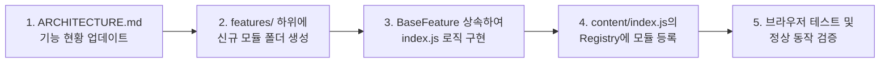
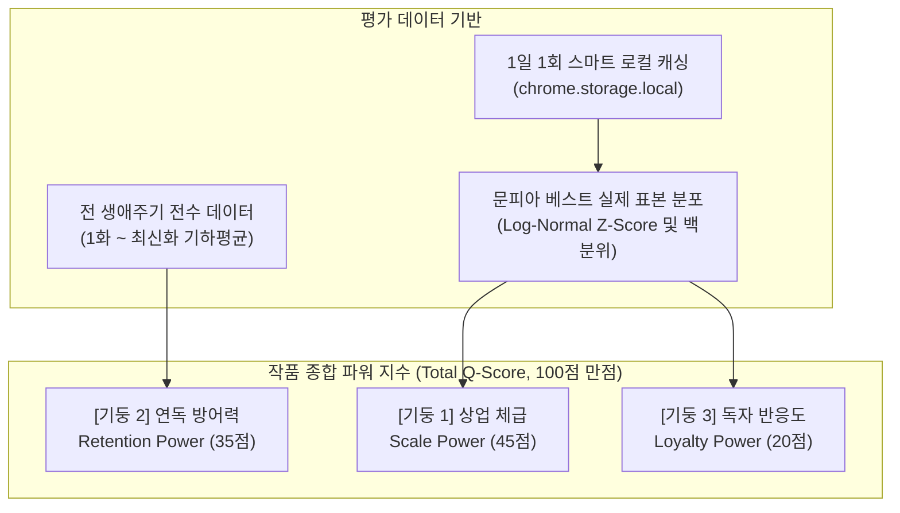

# 문피아 분석 유틸리티 확장 프로그램 아키텍처 및 구조 정의서 (ARCHITECTURE.md)

> **문서 목적**: 본 문서는 문피아(Munpia) 분석 유틸리티 확장 프로그램의 시스템 구조, 디렉터리 체계, 모듈 규격 및 신규 기능 추가 절차를 정의하는 **단일 진실 공급원(SSOT)**입니다.  
> 기능이 추가되거나 시스템 구조가 변경될 때마다 **이 문서를 가장 먼저 업데이트**합니다.

---

## 1. 아키텍처 설계 원칙

1. **플러그인/레지스트리 기반 확장성 (Plugin & Registry Pattern)**
   * 코어 엔진과 분석 기능(Feature)은 철저히 분리됩니다.
   * 새로운 분석 기능이 지속적으로 추가되더라도 **기존 코드를 수정하지 않고 독립된 모듈 파일 하나만 추가하여 등록**하는 구조를 유지합니다.
2. **SPA(단일 페이지 애플리케이션) 대응**
   * 문피아 웹 환경은 React 기반 SPA로 동작하며 URL 변경 및 비동기 DOM 렌더링이 일어납니다.
   * `PageWatcher` 코어 엔진이 DOM 변화와 URL 전환을 감시하여 적시에 기능 모듈을 안전하게 트리거합니다.
3. **독립적 생명주기 (Lifecycle Isolation)**
   * 각 기능은 초기화(`init`), 실행(`execute`), 해제(`destroy`)의 표준 생명주기를 가지며, 다른 기능의 오류가 전체 시스템에 영향을 주지 않도록 격리됩니다.
4. **무간섭(Non-intrusive) UI**
   * 문피아 원본 서비스의 레이아웃과 디자인 톤앤매너(다크모드 포함)를 해치지 않는 깔끔한 인라인 뱃지 및 컴포넌트 형태로 주입됩니다.

---

## 2. 전체 디렉터리 및 파일 구조

```text
munpia-utility-extension/
├── ARCHITECTURE.md                 # [본 문서] 시스템 구조 명세 및 기능 추가 가이드
├── manifest.json                   # Chrome Extension Manifest V3 설정 파일
│
├── src/
│   ├── background/                 # 백그라운드 서비스 워커
│   │   └── background.js           # 브라우저 이벤트 핸들링, 스토리지/알림 제어
│   │
│   ├── content/                    # 웹 페이지(novel.munpia.com)에 주입되는 컨텐츠 스크립트
│   │   ├── index.js                # 컨텐츠 스크립트 메인 진입점 (부트스트랩)
│   │   │
│   │   ├── core/                   # 프레임워크 코어 엔진
│   │   │   ├── page-watcher.js     # SPA URL 변경 및 DOM 동적 렌더링 감지 (MutationObserver)
│   │   │   ├── feature-registry.js # 기능 모듈의 등록, 조건 검사 및 실행 관리
│   │   │   └── dom-utils.js        # 공통 유틸리티 (숫자 파싱, 안전한 DOM 쿼리, 뱃지 렌더러)
│   │   │
│   │   ├── features/               # [기능 확장 지점] 개별 분석 기능 모듈들이 위치하는 디렉터리
│   │   │   ├── base-feature.js     # 모든 기능 모듈이 상속해야 하는 추상 인터페이스
│   │   │   │
│   │   │   ├── chapter-like-ratio/ # [기능 1] 회차별 조회수 대비 좋아요 비율 표시
│   │   │   │   ├── index.js        # 비율 계산 및 DOM 뱃지 주입 로직
│   │   │   │   └── style.css       # 뱃지 및 호버 툴팁 스타일
│   │   │   │
│   │   │   └── [feature-name]/     # [향후 기능 추가 영역] (예: 연독률 분석, 엑셀 추출 등)
│   │   │       ├── index.js
│   │   │       └── style.css
│   │   │
│   │   └── styles/
│   │       └── global.css          # 확장 프로그램 전역 공통 스타일 및 테마 변수
│   │
│   └── popup/                      # 브라우저 우측 상단 툴바 팝업 (기능 ON/OFF 및 옵션)
│       ├── popup.html
│       ├── popup.js
│       └── popup.css
│
└── icons/                          # 확장 프로그램 아이콘 에셋 (16, 48, 128px)
```

---

## 3. 핵심 모듈별 역할 명세

### 3.1 코어 엔진 (`src/content/core/`)
| 모듈명 | 주요 역할 |
| :--- | :--- |
| **`PageWatcher`** | • `history.pushState` / `popstate` 감지 및 SPA URL 변경 추적<br>• `MutationObserver`를 통해 회차 목록 등 핵심 DOM 요소의 렌더링 완료 감지<br>• DOM이 준비되면 `FeatureRegistry`에 실행 이벤트 디스패치 |
| **`FeatureRegistry`** | • 등록된 모든 기능 모듈(`BaseFeature`)의 레지스트리 관리<br>• 현재 URL 조건(`matches`) 및 사용자 활성화 여부를 확인하여 해당 기능 자동 실행<br>• 기능별 오류 처리(Try-Catch) 격리로 전체 확장 프로그램 안정성 보장 |
| **`DomUtils`** | • `parseNumber("15,420")` → 정수 파싱 유틸<br>• 회차 목록 행(Row) 탐색 및 안전한 요소 선택자 래퍼<br>• 문피아 테마(라이트/다크) 호환 컬러 뱃지 템플릿 생성기 |

### 3.2 기능 모듈 기본 규격 (`BaseFeature`)
모든 신규 기능은 `src/content/features/base-feature.js`를 상속하여 표준 규격을 준수해야 합니다.

```javascript
export class BaseFeature {
  constructor() {
    this.id = 'feature-id';             // 고유 식별자 (kebab-case)
    this.title = '기능 이름';            // 사용자 표시용 이름
    this.description = '기능 설명';      // 간단한 설명
    this.enabled = true;                // 활성화 여부
  }

  // 해당 페이지 URL이 본 기능의 동작 대상인지 판별
  matches(url) {
    return false; // e.g., url.includes('/novel/') || /^\/novel\/\d+/.test(pathname)
  }

  // 페이지 진입 시 1회 실행되는 초기화 로직
  init() {}

  // 대상 DOM이 렌더링/업데이트될 때마다 실행되는 핵심 분석 및 주입 로직
  execute(targetElement) {}

  // 페이지 이동 또는 기능 비활성화 시 주입한 요소 정리 (메모리 누수 방지)
  destroy() {}
}
```

---

## 4. 신규 기능 추가 워크플로우 (How to Add a New Feature)

향후 새로운 분석 기능(예: 연독률, 엑셀 다운로드 등)을 추가할 때는 반드시 다음 단계를 따릅니다:



1. **1단계: 본 문서(`ARCHITECTURE.md`) 업데이트**
   * 제 5장의 **[등록된 기능 목록]** 표에 신규 기능의 ID, 이름, 대상 페이지, 상태를 추가/기록합니다.
2. **2단계: 모듈 디렉터리 생성**
   * `src/content/features/[feature-name]/` 디렉터리를 생성합니다.
3. **3단계: 기능 구현**
   * `BaseFeature`를 상속하여 `index.js`에 데이터 추출, 계산, UI 주입 로직을 작성합니다.
   * 필요 시 모듈 전용 CSS(`style.css`)를 함께 작성합니다.
4. **4단계: FeatureRegistry에 등록**
   * `src/content/index.js`에서 작성한 모듈을 import하고 `FeatureRegistry.register(new MyFeature())`로 등록합니다.
5. **5단계: 검증**
   * 브라우저에서 대상 문피아 페이지를 새로고침하거나 이동하여 정상 렌더링을 확인합니다.

---

## 5. 등록된 기능 목록 (Feature Registry List)

> 이 표는 시스템에 존재하는 모든 기능의 현황판입니다. 새 기능 착수 시 `예정`으로 추가하고 완료 시 `활성화`로 갱신합니다.

| 기능 ID | 기능 이름 | 대상 URL 패턴 | 상태 | 설명 |
| :--- | :--- | :--- | :---: | :--- |
| `chapter-data-provider` | **전체 회차 백그라운드 API 데이터 제공자** | `munpia.com/*` (작품 상세) | ✅ 활성화 (v0.3.0) | 문피아 chapters API 비동기 프리페치로 전 회차 통계 및 이전 페이지 경계 회차 자동 매핑 |
| `chapter-analytics-inline` | **회차 메타 인라인 분석 (반응률/이탈률/1화대비)** | `munpia.com/*` (회차 목록) | ✅ 활성화 (v0.5.0) | 회차 메타의 '댓글' 뒤에 반응률, 직전 대비 이탈률, 1화 조회수 대비 비율(연독 잔존율) 인라인 표시 |
| `novel-summary-stats` | **무료 조회수 / 유료 구매수 전 회차 정밀 합산** | `munpia.com/*` (작품 상세) | ✅ 활성화 (v0.3.0) | 작품등록일 아랫줄에 단조로운 폰트로 전 회차 무료 조회수 및 유료 구매수 100% 실제 합산치 표시 |
| `novel-estimated-revenue` | **추정 매출 및 CP/작가 정산액(세후 순수익) 분석** | `munpia.com/*` (작품 상세) | ✅ 활성화 (v0.4.0) | 유료 구매수 기반 매출(100원), 플랫폼 수수료(37%), CP:작가(7:3/8:2/9:1) 세전/세후(3.3%) 순수익 산출 |
| `chapter-retention` | **1화 대비 연독률(잔존율) 인라인 표시** | `munpia.com/*` (회차 목록) | ✅ 활성화 (v0.5.0) | 모든 회차에 1화 조회수 기준 연독 비율(`1화대비 X.XX%`) 및 누적 이탈률 인라인 표시 |
| `novel-total-qscore` | **작품 종합 파워 지수 (Market Power Q-Score)** | `munpia.com/*` (작품 상세) | ✅ 활성화 (v0.6.1) | 3대 기둥(체급 45 / 연독 35 / 반응 20) 기반 전 생애주기 평가 및 문피아 시장 표본 백분위 모델 |
| `chapter-episode-qscore` | **회차별 퀄리티 스코어 (Episode Q-Score)** | `munpia.com/*` (회차 목록) | ✅ 활성화 (v0.6.0) | 각 회차 행에 단일 완성도 측정 점수 `[Q 82]` 뱃지 및 세부 유지/좋아요/댓글 점수 툴팁 주입 |
| `market-dashboard-leaderboard` | **문피아 시장 표본 평가 랭킹 리더보드 대시보드** | `전용 탭` (`src/dashboard/index.html`) | ✅ 활성화 (v0.7.1) | 4대 랭킹 665개 표본 줄 세우기, 추정 누적/회차당 매출 산출, 듀얼 정렬 칩, 실시간 시뮬레이터 및 3대 기둥 평가서 |
| `export-csv` | 회차 통계 CSV 다운로드 | `munpia.com/*` (작품 상세) | 📋 예정 | 전체 회차 통계 데이터를 엑셀(CSV)로 내보내기 |
| `view-trend-chart` | 연독률 추이 미니 그래프 | `munpia.com/*` (작품 상세) | 📋 예정 | 회차별 조회수/추천수 하락 추이를 시각화하는 차트 |
| `comment-ratio` | 회차별 댓글 참여율 분석 | `munpia.com/*` (회차 목록) | 📋 예정 | `(댓글수/조회수)*100%` 독자 반응성 분석 지표 |

---

## 6. 작품 종합 퀄리티 지수(Q-Score) 평가 모델 이론 및 설계 근거

> **문서화 목적**: 본 절은 기존 단순 수식 모델의 한계와 실패 원인을 분석하고, 새롭게 도입된 **3대 기둥 상업성 모델(Market Power Model)** 및 **실제 시장 표본 기반 통계 분포 함수 이론**의 설계 배경과 수학적 근거를 영구 보존하여 향후 유지보수 및 기능 확장의 길잡이로 삼습니다.  
> 📌 **상세 이론 및 전체 수식 명세**: [docs/MARKET_DISTRIBUTION_THEORY.md](docs/MARKET_DISTRIBUTION_THEORY.md) 참조



### 6.1 기존 단순 수식 모델의 실패 원인 분석 (Post-Mortem)

초기 프로토타입 공식은 다음과 같은 구조적 결함으로 인해 **159화 연재, 1.34억 원 매출의 흥행 대작이 28.8점(D급)으로 산출되는 치명적 왜곡**을 발생시켰습니다.

1. **상업성(구매력/매출)의 완전 배제**:
   - 회당 1만 구매수를 기록하여 억대 매출을 달성한 작품도 점수에 '단 1원'도 반영되지 않았습니다.
2. **단기 슬라이딩 윈도우(20화)의 '0점 클리프' 현상**:
   - $S_{ret} = \text{Clamp}\left(\frac{r - 0.990}{1.000 - 0.990}, 0, 1\right) \times 100$
   - 회당 유지율이 98.9%로 단 1.1%만 하락해도 전체 점수의 60% 비중을 차지하는 연독 점수가 **0점 처리**되었습니다. 150화 장기 연재에서 회당 1% 감쇠는 극히 자연스러운 현상임에도 이를 하위 0점으로 취급했습니다.
3. **무료 연재작의 고정 상한선(Hard Clamp) 모순**:
   - 선호작 상한선을 12,000명으로 고정해 두어, **1화 하루 만에 선호작 300명을 모은 역대급 괴물 신작**이 30화 완결 대작 기준 상한선(12,000명)과 단순 비교되어 겨우 10점대를 받는 모순이 발생했습니다.
   - 또한 특정 값(300명 등)을 만점으로 잘라버리면(Clamp), 300명, 500명, 700명을 기록한 초대박작들의 변별력이 완전히 증발해 버립니다.
4. **비선형 성장(S자 곡선) 무시**:
   - 웹소설의 성장은 1차 함수(선형)가 아닙니다. 1~7화(투베 밖 입소문 구간), 8~18화(투베 진입 폭발 구간), 19~25화(투베 상위 수렴 구간)의 **S자 곡선(Sigmoid / 지수 복리)** 특성을 반영해야 합니다.

---

### 6.2 3대 기둥 시장 파워 모델 (3-Pillar Market Power Model)

시장 상업성을 최우선 척도로 삼고, 1화부터 최신화까지 전 생애주기를 관통하여 평가하도록 재설계했습니다.

#### 1) [기둥 1] 상업 체급 (Scale Power, 45점 만점)
* **유료작**: 편당 평균 구매수(70%) + 총 누적 매출(30%) 로그 백분위 곡선.
* **무료작**: 선호작(60%) + 회당 평균 조회수(40%)의 잠재력 곡선.
* **신규 전환작 (Track T, 유료 1~9화)**: 유료화 직후 구매수 왜곡을 방지하기 위해 연재 화수 비율에 따라 무료 잠재력과 유료 실적을 부드럽게 합성:
  $$\text{Pillar 1} = (1 - w) \cdot \text{무료잠재력} + w \cdot \text{유료실적} \quad (w = N_{paid} / 10)$$

#### 2) [기둥 2] 연독 방어력 (Retention Power, 35점 만점)
* 최근 20화 슬라이딩 윈도우를 폐지하고, **1화부터 최신화까지 전 생애주기 기하평균 유지율**을 산출:
  $$r_{paid} = \left(\frac{V_{latest}}{V_{first}}\right)^{\frac{1}{N_{latest} - N_{first}}}, \quad r_{free} = \left(\frac{V_{f\_last}}{V_{f\_1}}\right)^{\frac{1}{N_{f\_last} - 1}}$$
  $$r = 0.85 \cdot r_{paid} + 0.15 \cdot r_{free}$$
* **0점 클리프 폐지**: 회당 92%~100% 구간을 0~100점으로 완만하게 정규화하여 일상적인 연독 감쇠를 정상 방어.
* **연참/성실 연재 보너스**: 1일 2화+ 연참 시 최대 +2.5점 가산.

#### 3) [기둥 3] 독자 반응도 (Loyalty Power, 20점 만점)
* 전체 회차 대상 좋아요 밀도(로그 정규화, 45%) + 댓글 몰입도(35%) + 선호작 대비 구매 전환율(20%)의 가중합.

---

### 6.3 실제 시장 표본 기반 통계 분포 함수 이론 (Empirical Distribution & Z-Score)

우리가 임의로 기준 숫자를 정하지 않고, **문피아 실제 시장 랭킹 표본 데이터의 분포 함수(Distribution Function)**를 도출하여 상대 백분위로 평가합니다.

#### 1) 로그 정규 분포 (Log-Normal Distribution)
웹소설 플랫폼의 선호작과 조회수는 지수적 멱함수 분포를 따르므로, 로그 변환 시 정규 분포를 이룹니다:
$$\ln(\text{지표}) \sim \mathcal{N}\left(\mu(N), \sigma^2(N)\right)$$
* $\mu(N)$: 연재 화수($N$)에 따른 문피아 전체 시장의 기대 평균 곡선 (Hill/로지스틱 성장 모델)
* $\sigma(N)$: 화수별 분산 곡선

#### 2) 시장 표준화 $Z$-점수 및 백분위 매핑
$$Z = \frac{\ln(\text{측정값}) - \mu(N)}{\sigma(N)}$$
$$Score = 100 \times \frac{1}{1 + e^{-0.85 \cdot Z}} \quad (\text{100점 점근 함수})$$

* **하드 캡 없는 연속 차등 수렴**:
  - 1화 선호작 300명 ($Z \approx +3.2$) $\rightarrow$ **96.0점 (S급)**
  - 1화 선호작 500명 ($Z \approx +3.6$) $\rightarrow$ **98.2점 (SS급)**
  - 1화 선호작 700명 ($Z \approx +4.2$) $\rightarrow$ **99.6점 (SSS급 신드롬)**
  - 무조건 같은 만점으로 자르지 않고, 성적이 높을수록 100점에 점근하며 체급 격차가 명확히 구분됩니다.
* **화수별 동적 공정성**:
  - 1화 시점의 300명은 상위 0.07%이므로 96점.
  - 25화 시점의 300명은 평균 이하이므로 42점. 화수에 맞춘 완벽한 시장 상대 평가 달성.

---

### 6.4 1일 1회 스마트 로컬 캐싱 아키텍처 (Daily Caching)

* **저장소**: `chrome.storage.local` (브라우저 로컬 스토리지)
* **캐시 키**: `munpia_market_stats_${YYYY-MM-DD}`
* **동작 메커니즘**:
  1. 당일(`2026-10-12`) 캐시 존재 시 외부 네트워크 요청 **100% 스킵 (0ms 즉시 반환)**.
  2. 문피아 서버 부하 및 사용자 IP 차단 위험 원천 차단.
  3. 네트워크 단절 또는 장애 발생 시 확장 프로그램에 번들링된 **기본 벤치마크 모수(Built-in Fallback)**로 무중단 연속 동작 보장.

---

## 7. 버전 관리 및 릴리즈 이력

본 프로젝트의 상세 버전별 변경 내역(신규 기능 추가, 버그 수정, 아키텍처 개편 등)은 프로젝트 루트의 **[CHANGELOG.md](CHANGELOG.md)**에서 독립적으로 관리됩니다.

* **현재 배포 버전**: `v0.8.1` (2026-10-15)
* **버전 관리 표준**: [Semantic Versioning 2.0.0](https://semver.org/lang/ko/) 및 [Keep a Changelog](https://keepachangelog.com/ko/1.0.0/) 준수
* **상세 변경 이력**: 전체 버전 히스토리는 [CHANGELOG.md](CHANGELOG.md)를 참조하십시오.

