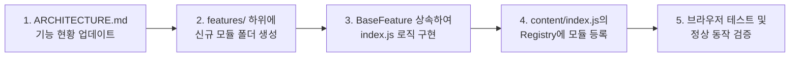

# 문피아 분석 유틸리티 확장 프로그램 아키텍처 및 구조 정의서 (ARCHITECTURE.md)

> **문서 목적**: 본 문서는 문피아(Munpia) 분석 유틸리티 확장 프로그램의 시스템 구조, 디렉터리 체계, 모듈 규격 및 신규 기능 추가 절차를 정의하는 **단일 진실 공급원(SSOT)**입니다.  
> 기능이 추가되거나 시스템 구조가 변경될 때마다 **이 문서를 가장 먼저 업데이트**합니다.

---

## 1. 아키텍처 설계 원칙

1. **플러그인/레지스트리 기반 확장성 (Plugin & Registry Pattern)**
   * 코어 엔진과 분석 기능(Feature)은 철저히 분리됩니다.
   * 새로운 분석 기능이 지속적으로 추가되더라도 **기존 코드를 수정하지 않고 독립된 모듈 파일 하나만 추가하여 등록**하는 구조를 유지합니다.
2. **SPA(단일 페이지 애플리케이션) 대응**
   * 문피아 웹 환경은 React 기반 SPA로 동작하며 URL 변경 및 비동기 DOM 렌더링이 일어납니다.
   * `PageWatcher` 코어 엔진이 DOM 변화와 URL 전환을 감시하여 적시에 기능 모듈을 안전하게 트리거합니다.
3. **독립적 생명주기 (Lifecycle Isolation)**
   * 각 기능은 초기화(`init`), 실행(`execute`), 해제(`destroy`)의 표준 생명주기를 가지며, 다른 기능의 오류가 전체 시스템에 영향을 주지 않도록 격리됩니다.
4. **무간섭(Non-intrusive) UI**
   * 문피아 원본 서비스의 레이아웃과 디자인 톤앤매너(다크모드 포함)를 해치지 않는 깔끔한 인라인 뱃지 및 컴포넌트 형태로 주입됩니다.

---

## 2. 전체 디렉터리 및 파일 구조

```text
munpia-utility-extension/
├── ARCHITECTURE.md                 # [본 문서] 시스템 구조 명세 및 기능 추가 가이드
├── manifest.json                   # Chrome Extension Manifest V3 설정 파일
│
├── src/
│   ├── background/                 # 백그라운드 서비스 워커
│   │   └── background.js           # 브라우저 이벤트 핸들링, 스토리지/알림 제어
│   │
│   ├── content/                    # 웹 페이지(novel.munpia.com)에 주입되는 컨텐츠 스크립트
│   │   ├── index.js                # 컨텐츠 스크립트 메인 진입점 (부트스트랩)
│   │   │
│   │   ├── core/                   # 프레임워크 코어 엔진
│   │   │   ├── page-watcher.js     # SPA URL 변경 및 DOM 동적 렌더링 감지 (MutationObserver)
│   │   │   ├── feature-registry.js # 기능 모듈의 등록, 조건 검사 및 실행 관리
│   │   │   └── dom-utils.js        # 공통 유틸리티 (숫자 파싱, 안전한 DOM 쿼리, 뱃지 렌더러)
│   │   │
│   │   ├── features/               # [기능 확장 지점] 개별 분석 기능 모듈들이 위치하는 디렉터리
│   │   │   ├── base-feature.js     # 모든 기능 모듈이 상속해야 하는 추상 인터페이스
│   │   │   │
│   │   │   ├── chapter-like-ratio/ # [기능 1] 회차별 조회수 대비 좋아요 비율 표시
│   │   │   │   ├── index.js        # 비율 계산 및 DOM 뱃지 주입 로직
│   │   │   │   └── style.css       # 뱃지 및 호버 툴팁 스타일
│   │   │   │
│   │   │   └── [feature-name]/     # [향후 기능 추가 영역] (예: 연독률 분석, 엑셀 추출 등)
│   │   │       ├── index.js
│   │   │       └── style.css
│   │   │
│   │   └── styles/
│   │       └── global.css          # 확장 프로그램 전역 공통 스타일 및 테마 변수
│   │
│   └── popup/                      # 브라우저 우측 상단 툴바 팝업 (기능 ON/OFF 및 옵션)
│       ├── popup.html
│       ├── popup.js
│       └── popup.css
│
└── icons/                          # 확장 프로그램 아이콘 에셋 (16, 48, 128px)
```

---

## 3. 핵심 모듈별 역할 명세

### 3.1 코어 엔진 (`src/content/core/`)
| 모듈명 | 주요 역할 |
| :--- | :--- |
| **`PageWatcher`** | • `history.pushState` / `popstate` 감지 및 SPA URL 변경 추적<br>• `MutationObserver`를 통해 회차 목록 등 핵심 DOM 요소의 렌더링 완료 감지<br>• DOM이 준비되면 `FeatureRegistry`에 실행 이벤트 디스패치 |
| **`FeatureRegistry`** | • 등록된 모든 기능 모듈(`BaseFeature`)의 레지스트리 관리<br>• 현재 URL 조건(`matches`) 및 사용자 활성화 여부를 확인하여 해당 기능 자동 실행<br>• 기능별 오류 처리(Try-Catch) 격리로 전체 확장 프로그램 안정성 보장 |
| **`DomUtils`** | • `parseNumber("15,420")` → 정수 파싱 유틸<br>• 회차 목록 행(Row) 탐색 및 안전한 요소 선택자 래퍼<br>• 문피아 테마(라이트/다크) 호환 컬러 뱃지 템플릿 생성기 |

### 3.2 기능 모듈 기본 규격 (`BaseFeature`)
모든 신규 기능은 `src/content/features/base-feature.js`를 상속하여 표준 규격을 준수해야 합니다.

```javascript
export class BaseFeature {
  constructor() {
    this.id = 'feature-id';             // 고유 식별자 (kebab-case)
    this.title = '기능 이름';            // 사용자 표시용 이름
    this.description = '기능 설명';      // 간단한 설명
    this.enabled = true;                // 활성화 여부
  }

  // 해당 페이지 URL이 본 기능의 동작 대상인지 판별
  matches(url) {
    return false; // e.g., url.includes('/novel/') || /^\/novel\/\d+/.test(pathname)
  }

  // 페이지 진입 시 1회 실행되는 초기화 로직
  init() {}

  // 대상 DOM이 렌더링/업데이트될 때마다 실행되는 핵심 분석 및 주입 로직
  execute(targetElement) {}

  // 페이지 이동 또는 기능 비활성화 시 주입한 요소 정리 (메모리 누수 방지)
  destroy() {}
}
```

---

## 4. 신규 기능 추가 워크플로우 (How to Add a New Feature)

향후 새로운 분석 기능(예: 연독률, 엑셀 다운로드 등)을 추가할 때는 반드시 다음 단계를 따릅니다:



1. **1단계: 본 문서(`ARCHITECTURE.md`) 업데이트**
   * 제 5장의 **[등록된 기능 목록]** 표에 신규 기능의 ID, 이름, 대상 페이지, 상태를 추가/기록합니다.
2. **2단계: 모듈 디렉터리 생성**
   * `src/content/features/[feature-name]/` 디렉터리를 생성합니다.
3. **3단계: 기능 구현**
   * `BaseFeature`를 상속하여 `index.js`에 데이터 추출, 계산, UI 주입 로직을 작성합니다.
   * 필요 시 모듈 전용 CSS(`style.css`)를 함께 작성합니다.
4. **4단계: FeatureRegistry에 등록**
   * `src/content/index.js`에서 작성한 모듈을 import하고 `FeatureRegistry.register(new MyFeature())`로 등록합니다.
5. **5단계: 검증**
   * 브라우저에서 대상 문피아 페이지를 새로고침하거나 이동하여 정상 렌더링을 확인합니다.

---

## 5. 등록된 기능 목록 (Feature Registry List)

> 이 표는 시스템에 존재하는 모든 기능의 현황판입니다. 새 기능 착수 시 `예정`으로 추가하고 완료 시 `활성화`로 갱신합니다.

| 기능 ID | 기능 이름 | 대상 URL 패턴 | 상태 | 설명 |
| :--- | :--- | :--- | :---: | :--- |
| `chapter-data-provider` | **전체 회차 백그라운드 API 데이터 제공자** | `munpia.com/*` (작품 상세) | ✅ 활성화 (v0.3.0) | 문피아 chapters API 비동기 프리페치로 전 회차 통계 및 이전 페이지 경계 회차 자동 매핑 |
| `chapter-analytics-inline` | **회차 메타 인라인 분석 (반응률/이탈률/1화대비)** | `munpia.com/*` (회차 목록) | ✅ 활성화 (v0.5.0) | 회차 메타의 '댓글' 뒤에 반응률, 직전 대비 이탈률, 1화 조회수 대비 비율(연독 잔존율) 인라인 표시 |
| `novel-summary-stats` | **무료 조회수 / 유료 구매수 전 회차 정밀 합산** | `munpia.com/*` (작품 상세) | ✅ 활성화 (v0.3.0) | 작품등록일 아랫줄에 단조로운 폰트로 전 회차 무료 조회수 및 유료 구매수 100% 실제 합산치 표시 |
| `novel-estimated-revenue` | **추정 매출 및 CP/작가 정산액(세후 순수익) 분석** | `munpia.com/*` (작품 상세) | ✅ 활성화 (v0.4.0) | 유료 구매수 기반 매출(100원), 플랫폼 수수료(37%), CP:작가(7:3/8:2/9:1) 세전/세후(3.3%) 순수익 산출 |
| `chapter-retention` | **1화 대비 연독률(잔존율) 인라인 표시** | `munpia.com/*` (회차 목록) | ✅ 활성화 (v0.5.0) | 모든 회차에 1화 조회수 기준 연독 비율(`1화대비 X.XX%`) 및 누적 이탈률 인라인 표시 |
| `export-csv` | 회차 통계 CSV 다운로드 | `munpia.com/*` (작품 상세) | 📋 예정 | 전체 회차 통계 데이터를 엑셀(CSV)로 내보내기 |
| `view-trend-chart` | 연독률 추이 미니 그래프 | `munpia.com/*` (작품 상세) | 📋 예정 | 회차별 조회수/추천수 하락 추이를 시각화하는 차트 |
| `comment-ratio` | 회차별 댓글 참여율 분석 | `munpia.com/*` (회차 목록) | 📋 예정 | `(댓글수/조회수)*100%` 독자 반응성 분석 지표 |

---

## 6. 버전 관리 및 변경 이력

| 버전 | 일자 | 변경 내용 | 작성자 |
| :---: | :---: | :--- | :---: |
| **v0.5.0** | 2026-10-12 | • [신규 지표 인라인화] **1화 조회수 대비 모든 회차 조회수(or 구매수) 비율(`1화대비 X.XX%`)** 인라인 항목 추가<br>• 회차 메타 행에 `비율`, `이탈률`과 함께 `1화대비` 연독 잔존율이 나란히 표시되도록 UI 확장<br>• 마우스 호버 시 1화 조회수 기준치 및 누적 이탈률(`100% - 잔존율`) 툴팁 제공 | Antigravity |
| **v0.4.3** | 2026-10-08 | • [에러/경고 방지] 소설 본문 읽기 뷰어 화면(`/viewer/`)에서는 확장 프로그램이 불필요하게 실행되지 않도록 URL 매칭 예외 처리<br>• 크롬 확장 관리 페이지(`chrome://extensions`)에 불필요한 경고(`console.warn`) 로그가 남지 않도록 안정화 | Antigravity |
| **v0.4.2** | 2026-10-08 | • [상단 메타 행 통합] **추정 매출**과 **플랫폼 수수료**를 **무료 조회수 · 유료 구매수**와 동일한 1행에 인라인 배치하여 일목요연하게 정리<br>• [완전 좌측 정렬] 출판사 정산 및 하위 비율 목록(`90%`, `80%`, `70%`)을 좌측 끝 정렬(`margin-left: 0`, `align-items: flex-start`)로 완전히 고정하여 우측 쏠림 현상 해결 | Antigravity |
| **v0.4.1** | 2026-10-08 | • [레이아웃 최적화] 추정 매출 및 출판사 정산(작가 몫 90%/80%/70% 및 세후 순수익) 수직 줄바꿈(Line-by-Line) 정렬 적용<br>• 가로 폭 협소로 인한 어색한 줄바꿈 현상 원천 해결 및 들여쓰기 가독성 대폭 향상 | Antigravity |
| **v0.4.0** | 2026-10-08 | • [신규 기능] **작품 추정 수익 및 작가 정산액(세후 순수익) 계산기** 도입<br>• 회차별 유료 구매수 기반 총 매출(`구매수 × 100원`) 산출<br>• 플랫폼 수수료(37%) 및 잔여 정산금(63%) 분리<br>• 출판사:작가 3대 정산 비율(`7:3`, `8:2`, `9:1`)별 작가 정산액 및 3.3% 원천징수 세후 순수익 정밀 계산 표시<br>• 조회수/구매수 바로 아랫줄에 문피아 순정 폰트 스타일로 완벽 안착 | Antigravity |
| **v0.3.3** | 2026-10-08 | • [상단 요약 위치 버그 원천 해결] 상위 `#root` 컨테이너 오인식으로 페이지 최하단(바닥 끝)에 렌더링되던 버그 수정<br>• 상단 메타(`_infoRows_`) 내부의 '작품등록일' 행 직후에 순정 `_infoRow_` 클래스를 상속한 정갈한 새 행(div)으로 정확히 주입<br>• 이전에 최하단 등에 오배치되었던 찌꺼기 DOM 자동 제거 및 `_infoRows_` 레이아웃 강제 확장 보정 | Antigravity |
| **v0.3.2** | 2026-10-08 | • [상단 집계 렌더링 안정화] 무료 연재(일반/자유연재 등 전 회차 무료) 작품에서 상단 총 조회수를 완벽히 인식하여 `무료 조회수 XXX ∙ 유료 구매수 0` 즉시 표시 보장<br>• [레이아웃 보정] `_infoRows_` 70px 높이 강제 해제 및 다크 테마 컬러 동기화 완료 | Antigravity |
| **v0.3.1** | 2026-10-08 | • [정렬순 버그 해결] '최신순' / '1화부터' 탭 전환에 따른 화면 렌더링 순서 의존성 완전 제거<br>• 회차 고유 번호(`N화`)를 제목/링크에서 엄격히 파싱하여, 화면 배치와 무관하게 **반드시 이전 연재 회차인 `(N - 1)화`와 비교하여 시간순 이탈률을 100% 일관되게 산출**하도록 보정 | Antigravity |
| **v0.3.0** | 2026-10-08 | • [코어 모듈 추가] 문피아 내부 `chapters` API 백그라운드 프리페치 엔진(`ChapterDataProvider`) 구현<br>• [이탈률 보정] 2페이지 31화, 3페이지 61화 등 페이지 경계에 위치한 회차도 이전 페이지(30화 등) 데이터를 백그라운드로 가져와 이탈률 100% 산출<br>• [정밀 합산] 화면 렌더링 개수(30개)에 한정되지 않고, 작품의 전체 1화~완결화까지 **무료 조회수 총합과 유료 구매수 총합을 실제 전 회차 데이터 기반으로 100% 정밀 집계** | Antigravity |
| **v0.2.1** | 2026-10-08 | • [UI 최적화] 회차 높이 고정에 따른 잘림 현상 해결: '댓글' 뒤에 동일한 폰트 스타일로 인라인 연결 (`반응률 X.XX%`, `이탈률 X.XX%`)<br>• [상단 요약] 화려한 박스/아이콘 제거 후 '작품등록일' 바로 아랫줄에 기본 폰트 스타일로 통일<br>• [버그 픽스] 상단 요약 바 DOM 갱신 시 깜빡거림 현상 및 데이터 합산 캐싱 안정화 | Antigravity |
| **v0.2.0** | 2026-10-08 | • 회차 레이아웃 개선: 1열 인라인 뱃지 대신 바로 아랫줄에 [2번째 줄 전용 분석 행] 신설<br>• 회차 분석 행에 **좋아요 반응률**, **직전 대비 이탈률(📉)**, **1화 대비 잔존율(🎯)** 3개 칩 시각화<br>• 상단 작품 메타에 **무료 조회수 합계 vs 유료 구매수 합산(총 판매 부수)** 분리 요약 바 주입 기능(`novel-summary-stats`) 추가<br>• 팝업 UI v0.2.0 갱신 및 manifest.json 등록 완료 | Antigravity |
| **v0.1.2** | 2026-10-08 | • 유료 회차의 '구매' 라벨(조회수 대체) 인식 및 비율 계산 완벽 지원<br>• 회차 유형(무료/유료)에 따른 툴팁 문구(조회수/구매수) 자동 분기 | Antigravity |
| **v0.1.1** | 2026-10-08 | • 최신 문피아 웹(`munpia.com/novel/detail/:id`) URL 매칭 규칙 보강<br>• 신규 React SPA 회차 목록(`_itemMeta_`, `_metaGroup_`) 셀렉터 및 지연 로딩 폴링 대응 | Antigravity |
| **v0.1.0** | 2026-10-08 | • Manifest V3 기반 코어 프레임워크 구축 (`PageWatcher`, `FeatureRegistry`, `DomUtils`)<br>• [기능 1] 회차별 좋아요/조회수 비율 분석 모듈(`chapter-like-ratio`) 및 CSS 뱃지 구현 완료<br>• 팝업 대시보드 및 기본 아이콘(16, 48, 128px) 생성 | Antigravity |
| **v0.0.1** | 2026-10-06 | 초기 아키텍처 정의, 디렉터리 구조 및 기능 확장 가이드 수립 | Antigravity |

